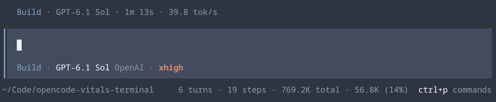

# OpenCode Vitals Terminal

**Session usage, below your prompt and in your sidebar.**

Turns, model steps, cumulative tokens, context usage, and cost **in OpenCode V2's existing terminal prompt footer and session sidebar**. No separate dashboard, desktop renderer injection, server hooks, telemetry, or extra model requests.

**For the full-screen terminal client**, not Desktop or `opencode mini`.

Inspired by [OpenCode Vitals](https://github.com/moutazideal/opencode-vitals) and its idea of keeping session metrics beside the composer. This project brings that idea to the terminal with usage counts, not streaming tokens per second.



```text
~/code/project                  8 turns · 42 steps · 320K total · 24K (19%) · $0.43
```

The line automatically abbreviates on smaller terminals:

```text
8t · 42s · 320K total · 24K
```

When OpenCode's right sidebar is visible, a **Vitals** section shows the full metrics with exact counts:

```text
Vitals
Turns: 8
Steps: 42
Total tokens: 320,000
Context: 24,000 (19%)
Cost: $0.43
```

With the sidebar visible, the footer switches to a standard-style model-context summary, without repeating turns, steps, cumulative tokens, or cost:

```text
~/code/project                                                    24K (19%)
```

Hiding the sidebar or narrowing the terminal restores the full vitals footer. This follows the sidebar's actual visibility, including manual toggling, rather than just terminal width. Both views share the same history and live updates.

Click the footer summary or sidebar vitals section, or run `/vitals`, for an input/output/reasoning/cache breakdown. `/vitals-refresh` rereads the session history if needed.

## What you get

| Feature | What it does |
| --- | --- |
| **Session counts** | Delivered user turns and primary model steps for the session you are viewing, including work in progress. |
| **Usage at a glance** | Cumulative provider-reported tokens beside the original context estimate and optional cost display. |
| **Details on demand** | Click the summary or run `/vitals` for exact counts and a token breakdown. |
| **History-aware totals** | Read full history on resume and reconnect, and exclude reverted messages after undo. Incomplete totals are marked with `~`. |
| **A footer that fits** | Abbreviate on narrow terminals while retaining the host's spinner, working directory, and editor-file display. |
| **Sidebar vitals** | Show exact counts in the right sidebar when it is visible, with a context-only footer. Restore the full footer when the sidebar is hidden. |

## Install

Requires **OpenCode V2 2.0.26 or later**, with the CLI plugin API. Tested against 2.0.26 and 2.0.27. OpenCode supplies the runtime that loads the plugin.

### Install from npm (recommended)

The plugin is published as [`opencode-vitals-terminal` on npm](https://www.npmjs.com/package/opencode-vitals-terminal). OpenCode installs the npm package and supplies the runtime that loads the plugin; no separate `npm install` is needed.

Merge these entries into `plugins` in `~/.config/opencode/cli.json` (or `$XDG_CONFIG_HOME/opencode/cli.json`):

```json
{
  "$schema": "https://opencode.ai/v2/cli.json",
  "plugins": [
    "-opencode.prompt.footer",
    "-opencode.sidebar.context",
    "opencode-vitals-terminal"
  ]
}
```

**Keep your other settings and plugin entries.** [`cli.example.json`](cli.example.json) contains an example with options; do not copy it over an existing config. To pin a release, use `opencode-vitals-terminal@0.1.0` instead of the unversioned package name.

The first entry disables only the built-in footer contribution that contains the original token/cost line. Without it, both summaries appear. Our contribution uses the same `prompt.footer` slot, rather than replacing the whole footer: the host's spinner, working directory, interrupt status, and editor-file display remain intact. Shell-mode hints, command/agent shortcuts when space permits, and running-subagent/shell indicators are retained.

The `-opencode.sidebar.context` entry disables OpenCode's built-in **Context** section, since Vitals already includes context usage and cost. Only that duplicate section is hidden; the rest of the sidebar and our prompt footer stay intact. If you already installed the plugin, add this entry to your existing `plugins` array.

Restart or reload the terminal client to load the plugin.

### Install from source

Use **Node 26.4.0 or newer** and npm for the checkout's dependencies and development checks, matching OpenTUI's declared Node runtime minimum:

```sh
git clone https://github.com/skatkov/opencode-vitals-terminal.git
cd opencode-vitals-terminal
npm ci
```

For **mise** users, `mise.toml` pins a compatible Node version for this checkout. Run `mise install` before `npm ci`. If mise is not activated in your shell, use `mise exec -- npm ci` instead.

In the configuration above, replace `opencode-vitals-terminal` with the absolute path to your checkout, such as `/absolute/path/opencode-vitals-terminal`. Keep both `-opencode.prompt.footer` and `-opencode.sidebar.context` entries, then restart or reload the terminal client.

### Preview without changing configuration

```sh
OPENCODE_CLI_CONFIG_CONTENT='{"plugins":["-opencode.prompt.footer","-opencode.sidebar.context","/absolute/path/opencode-vitals-terminal"]}' opencode
```

The environment override replaces the configured plugin array for that process; include any other terminal plugins you want in that preview.

## Options

Use the package name (or your checkout's absolute path) in the object form when passing options:

```json
{
  "plugins": [
    "-opencode.prompt.footer",
    "-opencode.sidebar.context",
    {
      "package": "opencode-vitals-terminal",
      "options": {
        "tokens": "both",
        "cost": true
      }
    }
  ]
}
```

| Option | Default | Meaning |
| --- | --- | --- |
| `tokens` | `"both"` | `"both"`: total tokens and current context. `"context"`: the original token-count semantics, plus turns/steps. `"total"`: cumulative tokens only. |
| `cost` | `true` | Show cost in the vitals sidebar and, when space permits, the full vitals footer. |

Both options apply to the sidebar and the full vitals footer shown when the sidebar is hidden. When the sidebar is visible, the footer always shows model-context usage only, regardless of these options. The installation configuration disables only the duplicate built-in Context section; other sidebar content stays intact.

## What the numbers mean

- **Turns:** delivered user messages in this session's timeline. Includes the current turn. Steering messages count as separate user turns; this is **not** a count of completed assistant responses. Queued/pending messages, synthetic messages, and shell commands do not count.
- **Steps:** distinct primary assistant/model-call messages, including a call in progress or a failed call. Multiple tool calls in one response are one step. Provider retries reusing the same assistant message ID do not inflate the counter. Title generation and compaction are not primary steps.
- **Total:** cumulative provider-reported token usage: input + output + reasoning + cache-read + cache-write across primary model steps. Repeated context/cache tokens are counted per request, just as in OpenCode's usage accounting. This is neither unique transcript size nor billed cost. Usage updates when the provider finishes a step; missing usage is not estimated. Auxiliary title/compaction/generate usage is excluded.
- **Context:** the unlabeled token count after the cumulative total. This is the original footer's estimate: the latest primary step's token usage since the last completed compaction, with its model's context-window percentage when known. It is not the cumulative token total.
- **Cost:** OpenCode's existing session-cost value, which can include auxiliary work and descendants. It is not recalculated from the primary-step token total.

Turn, step, and token counters are **for the session you are viewing**. Subagent sessions have their own counters; the running-subagent indicator is still displayed.

Full history is paginated independently of the TUI's recent-message cache, so resuming a long session does not reset its counters. Until history finishes loading, or if it cannot be read, incomplete totals carry a `~` prefix. Context remains available from the recent-message cache. Reconnects reread history, and staged/committed undo excludes the reverted part of the timeline. Removed history is not a lifetime-spend ledger.

On narrow terminals the labels abbreviate first, then cost/context percentage are omitted. On very narrow terminals the context field may also be omitted; the detailed `/vitals` view remains available.

## Privacy

Only lightweight usage metadata is kept in client memory. The plugin does not persist or log prompts, responses, file attachments, or tool output. There is no telemetry or separate analytics service. History comes from the connected OpenCode server, including remote servers, through the TUI's existing authenticated client. Disabling/reloading the plugin unsubscribes events and aborts its pending history reads.

## Remove

Remove this plugin's entry, `-opencode.prompt.footer`, and `-opencode.sidebar.context` from `cli.json`, then restart or reload the terminal client. Removing the disabling entries restores OpenCode's built-in footer contribution and Context section. Keep your other plugin entries and settings.

## Development

```sh
npm ci
npm run check
npm test
npm pack --dry-run
```

The host loads the TypeScript/TSX entrypoints directly; no build is required. OpenTUI/Solid are peer dependencies supplied by the host. Local tests exercise accounting, pagination, deduplication, responsive formatting, sidebar lifecycle, undo boundaries, concurrent reads, and cleanup without making model requests.

The plugin was also smoke-tested in the actual OpenCode 2.0.26 TUI at 160, 80, and 44 columns, including the `/vitals` dialog and live counter updates. Loading it did not require changing global configuration.

The development dependency override keeps `seroval` on a patched release. If npm reports `EBADENGINE`, check `node --version` and upgrade to Node 26.4.0 or newer (or run `mise install` and use `mise exec -- npm ci`).

For npm versions with install-script approvals, `allowScripts` explicitly denies the optional `msgpackr-extract` native build script. MessagePack decoding still works without native acceleration, using the JavaScript fallback. This avoids unreviewed-script warnings without enabling dependency install scripts broadly.

CI runs the same install, type check, tests, and package preview on pushes and pull requests, using Node 26. Publishing is manual, as in `opencode-lightpanda`.

API references: [CLI plugins](https://opencode.ai/v2/docs/build/plugins/cli/) · [CLI plugin configuration](https://opencode.ai/v2/docs/cli/plugins/).

### Mutation testing

[StrykerJS](https://stryker-mutator.io/docs/stryker-js/getting-started/) checks the tests by making small changes to production code and verifying that tests fail. Run it with the same Node 26.4.0-or-newer runtime used for development:

```sh
npm run test:mutation
```

If mise is not activated in your shell, use `mise exec -- npm run test:mutation`.

Open `reports/mutation/index.html` for the interactive report; `reports/mutation/mutation.json` contains the machine-readable results. Reports and Stryker's temporary sandbox are ignored by git.

`stryker.config.mjs` targets the logic in `src/**/*.ts`, including accounting, history, formatting, and reactive stores/views. It does not mutate tests or the host-loaded `index.ts` and `tui.tsx` entrypoints, which the unit suite does not load. The TAP runner uses the existing `node:test` tests unchanged, preserving Solid's `browser` condition and Node's TypeScript stripping, with coverage-based selection at the test-file level. Mutation testing is slower than `npm test`; up to four mutation workers run concurrently.

Stryker is a development-only dependency. A scoped override keeps its transitive `qs` dependency on a patched release without changing the plugin's runtime dependencies.

For a quicker configuration check or a focused run:

```sh
npm run test:mutation -- --dryRunOnly
npm run test:mutation -- --mutate src/metrics.ts
```

No minimum mutation score is enforced initially (`thresholds.break` is `null`). Review surviving mutants in the report to identify missing assertions or equivalent changes before choosing a score gate.

The separate **Mutation testing** GitHub Actions workflow runs on demand via **Run workflow** and uploads the reports as the `mutation-report` artifact. It does not slow down push/pull-request CI or publishing, and no Stryker dashboard credentials are needed.

## Publishing

The initial release is `0.1.0`. From an npm account with permission to publish `opencode-vitals-terminal`:

```sh
npm ci
npm login
npm publish --dry-run
npm publish
```

`prepublishOnly` runs the type check and tests for both publish commands. The package ships the TypeScript/TSX entrypoints and runtime source directly, with the README, screenshot, example configuration, and license; no compilation step is needed. `publishConfig` targets the public npm registry.

For subsequent releases, bump the version with `npm version patch` (or `minor`/`major`) and commit and push the release changes and tag before publishing. npm will not overwrite an already published version.

## License

MIT. See [LICENSE](LICENSE).
